# blockchain-reward-platform

ระบบแต้มสะสมและตลาดคูปองบน EVM chain · NestJS · Prisma · PostgreSQL 16

[](https://github.com/najaroenx/blockchain-reward-platform/issues)
[](https://github.com/najaroenx/blockchain-reward-platform/milestones)
[](https://github.com/najaroenx/blockchain-reward-platform/wiki/Acceptance-Overview)
[](https://github.com/najaroenx/blockchain-reward-platform/wiki)

> **สถานะวันนี้ · repo นี้ยังไม่มีโค้ด**
> สิ่งที่มีคือ **ข้อกำหนดที่พิสูจน์แล้ว** จาก dev pack 14 ชุด ได้แก่ schema ที่รันบน PostgreSQL จริง
> สเปค API ครบทุก endpoint และกฎ 366 ข้อที่ทดสอบผ่านแล้วในชั้นฐานข้อมูล
> งานรอบนี้คือเขียนโค้ดขึ้นใหม่ทั้งหมดโดยใช้ของเหล่านั้นเป็นข้อกำหนด

---

## เริ่มตรงไหน

| ถ้าคุณคือ | ไปที่ |
|---|---|
| เพิ่งเข้าทีม | [สถาปัตยกรรมและข้อที่ล็อกไว้](https://github.com/najaroenx/blockchain-reward-platform/wiki/Architecture) แล้วต่อด้วย [อภิธานศัพท์](https://github.com/najaroenx/blockchain-reward-platform/wiki/Glossary) |
| จะหยิบงานไปทำ | [Project board](https://github.com/users/najaroenx/projects/1) กรอง `sprint:"Sprint 1"` |
| จะต่อ API | [API ทั้งหมด 53 endpoint](https://github.com/najaroenx/blockchain-reward-platform/wiki/API-Reference) |
| ดูฐานข้อมูล | [ตารางทั้งหมด](https://github.com/najaroenx/blockchain-reward-platform/wiki/Database-Tables) |
| รีวิว pull request | [Definition of Done](https://github.com/najaroenx/blockchain-reward-platform/wiki/Definition-of-Done) |
| ต้องตัดสินใจ | [15 เรื่องที่ยังไม่ตัดสิน](https://github.com/najaroenx/blockchain-reward-platform/wiki/Open-Decisions) |

---

## ระบบนี้ทำอะไร

ร้านค้าสมัครเข้าระบบแล้วได้ wallet บน chain ของตัวเอง สร้างสกุลแต้มและคูปองของตัวเอง
แจกให้ลูกค้า และเปิดให้ซื้อขายกันในตลาด โดยเงินบาทจริงที่เติมเข้ามาถูกแปลงเป็น THB บน chain แบบหนึ่งต่อหนึ่ง

| | |
|---|---|
| Feature pack | **14** |
| Acceptance test ที่ผ่าน | **366** · ไม่ผ่าน 0 |
| ตารางในฐานข้อมูล | 180 (นับรวมทุก pack · หลังรวมเป็น schema เดียวราว 49) |
| Trigger · ฟังก์ชัน | 60 · 81 |
| API endpoint | 53 |
| งานที่วางไว้ | **114 task** · 506 point · 13 sprint |

---

## สถาปัตยกรรม

สาม process แยกกันตั้งแต่วันแรก ไม่ใช่แยกทีหลัง · `api` ไม่เคยแตะ chain และ `worker` ไม่เคยรับ request จากภายนอก

```mermaid
flowchart LR
    C["client"]
    subgraph api["api · รับงาน"]
      A1["ตรวจ Idempotency-Key<br/>สเตตเมนต์แรก · R1"]
      A2["ตรวจกฎด้วย trigger<br/>ไม่ใช่ guard ในโค้ด"]
      A3["เขียน operation<br/>operation_step · outbox"]
    end
    subgraph db["PostgreSQL · แหล่งความจริง"]
      DB[("49 ตาราง<br/>60 trigger · 81 ฟังก์ชัน")]
    end
    subgraph worker["worker · ทำงานบน chain"]
      W1["หยิบจาก outbox<br/>SKIP LOCKED + lease"]
      W2["ขอ nonce<br/>uq_signer_nonce"]
      W3["เซ็นที่ KMS<br/>ไม่เคยถือ key · L6"]
      W4["เขียน raw_tx แล้ว COMMIT<br/>ck_rawtx_before_broadcast · R2"]
      W5["broadcast"]
    end
    N(["EVM chain"])
    subgraph idx["indexer + projector · อ่านผลกลับ"]
      I1["อ่าน log ตามช่วงบล็อก"]
      I2["เขียน chain_event<br/>ขยับ cursor ใน tx เดียว · L8"]
      I3["projector เขียน projection<br/>CONFIRMED แล้ว FINALIZED"]
    end
    C -->|"POST /v1/..."| A1 --> A2 --> A3 --> DB
    A3 -.->|"201 หรือ 202 + operationId"| C
    DB --> W1 --> W2 --> W3 --> W4 --> W5 --> N
    N --> I1 --> I2 --> I3 --> DB
    DB -.->|"GET /v1/operations/{id}"| C
```



### ข้อที่ล็อกแล้ว ไม่เปิดถกใหม่ระหว่างทาง

| | |
|---|---|
| `L1` | deploy contract ใหม่ทั้งหมด ไม่ reuse ของเดิม |
| `L2` | api · worker · indexer เป็นคนละ process ตั้งแต่วันแรก |
| `L3` | `numeric(78,0)` base units ทั้งระบบ ส่งบน wire เป็น string |
| `L4` | ไม่ migrate ข้อมูลจากระบบเดิมเลย ลูกค้าเริ่มจากศูนย์ |
| `L5` | ระบบใหม่ใช้ signer address ของตัวเอง ไม่งั้น nonce ชนกัน |
| `L6` | ตาราง `wallet` ไม่มีคอลัมน์ private key และไม่มีวันมี · บังคับด้วย DDL event trigger |
| `L7` | idempotency fingerprint ห้ามใช้ salt, secret หรือ HMAC |
| `L8` | indexer รัน instance เดียว · cursor ขยับใน transaction เดียวกับ `chain_event` |

### กฎสองข้อที่ทุก pull request ต้องผ่าน

- **`R1`** idempotency เป็นสเตตเมนต์แรกของ transaction **ห้าม `try/catch` ครอบ** เพราะสเตตเมนต์ที่ error ทำให้ transaction aborted ด้วย `25P02` แล้วทุกอย่างหลังจากนั้นพังเงียบ
- **`R2`** `raw_tx` ต้อง commit **ก่อน** broadcast · การยิง tx ออกไปโดยยังไม่บันทึกว่ายิงอะไร คือการสูญเสีย tx

---

## Feature ทั้ง 14

| Phase | Pack | ชื่อ | ตาราง | Trigger | ข้อรับประกัน |
|---|---|---|---|---|---|
| 1 | **FEAT-01** | [Merchant Onboarding](https://github.com/najaroenx/blockchain-reward-platform/wiki/FEAT-01-Merchant-Onboarding) | 11 | 0 | 14 |
| 1 | **FEAT-02** | [Customer Register + OTP](https://github.com/najaroenx/blockchain-reward-platform/wiki/FEAT-02-Customer-Register-OTP) | 12 | 6 | 39 |
| 1 | **FEAT-03** | [Auth · login, token, refresh](https://github.com/najaroenx/blockchain-reward-platform/wiki/FEAT-03-Auth-login-token-refresh) | 7 | 0 | 15 |
| 2 | **FEAT-04** | [Create Point Type](https://github.com/najaroenx/blockchain-reward-platform/wiki/FEAT-04-Create-Point-Type) | 12 | 2 | 17 |
| 3 | **FEAT-05** | [Transfer Point](https://github.com/najaroenx/blockchain-reward-platform/wiki/FEAT-05-Transfer-Point) | 15 | 2 | 20 |
| 2 | **FEAT-06** | [Point Balance · bucket + expiry](https://github.com/najaroenx/blockchain-reward-platform/wiki/FEAT-06-Point-Balance-bucket-expiry) | 9 | 2 | 20 |
| 2 | **FEAT-07** | [Coupon Type + Issue](https://github.com/najaroenx/blockchain-reward-platform/wiki/FEAT-07-Coupon-Type-Issue) | 12 | 4 | 23 |
| 3 | **FEAT-11** | [Redeem Coupon](https://github.com/najaroenx/blockchain-reward-platform/wiki/FEAT-11-Redeem-Coupon) | 14 | 0 | 12 |
| 3 | **FEAT-08** | [List on Marketplace](https://github.com/najaroenx/blockchain-reward-platform/wiki/FEAT-08-List-on-Marketplace) | 14 | 4 | 25 |
| 3 | **FEAT-09** | [Delist](https://github.com/najaroenx/blockchain-reward-platform/wiki/FEAT-09-Delist) | 15 | 7 | 34 |
| 3 | **FEAT-10** | [Buy Coupon](https://github.com/najaroenx/blockchain-reward-platform/wiki/FEAT-10-Buy-Coupon) | 20 | 10 | 36 |
| 2 | **FEAT-12** | [THB Deposit & Mint](https://github.com/najaroenx/blockchain-reward-platform/wiki/FEAT-12-THB-Deposit-Mint) | 16 | 9 | 34 |
| 4 | **FEAT-13** | [Operation Status + Webhook](https://github.com/najaroenx/blockchain-reward-platform/wiki/FEAT-13-Operation-Status-Webhook) | 10 | 9 | 41 |
| 4 | **FEAT-14** | [Indexer + Projector](https://github.com/najaroenx/blockchain-reward-platform/wiki/FEAT-14-Indexer-Projector) | 13 | 5 | 36 |

Phase 1 ตัวตน · Phase 2 ออกสินทรัพย์ · Phase 3 ซื้อขาย · Phase 4 worker กับ indexer

---

## สิ่งที่ยังไม่มี · อ่านก่อนประเมินงาน

ตัวเลข 366 ข้อคือข้อยืนยัน **ระดับ schema** ที่รันบน PostgreSQL จริง ไม่ใช่ unit test ของแอป
ทั้ง 14 pack เขียนตรงกันว่าของเหล่านี้ยังไม่มีโค้ด

| | ช่องว่าง | ปิดที่ |
|---|---|---|
| `G1` | worker ที่เซ็นและ broadcast ยังไม่มีโค้ดเลย | `EP-01` |
| `G2` | contract จริงและ ABI ยังไม่มี มีแต่ข้อกำหนดว่าต้องมีฟังก์ชันอะไร | `EP-02` |
| `G3` | การเซ็น JWT ยังเป็น interface เปล่า | `EP-01` |
| `G4` | KMS ยังเป็นแค่ reference ในตาราง | `EP-01` |
| `G5` | ไม่มี test เหนือระดับ schema เลย ทั้ง unit, integration และ e2e | `EP-10` |
| `G6` | projector ยังเป็นโครง · `decodeLog` ยังไม่ถอดจาก log จริง | `EP-02` |
| `G7` | ค่า N ที่ถือว่า final ยังไม่มีใครตัดสิน | ตัดสินใจ `D1` |
| `G8` | `MANUAL_REVIEW` ไม่มีเครื่องมือให้คนแก้ · กรณี reorg ทำให้ indexer ค้างทั้งระบบ | `EP-10` |

ดูรายละเอียดที่ [เรื่องที่ยังไม่ตัดสิน](https://github.com/najaroenx/blockchain-reward-platform/wiki/Open-Decisions)

---

## แผนงาน

114 task · 506 point · 13 sprint สองสัปดาห์ต่อรอบ สมมติทีม backend 3 ถึง 4 คน

| Epic | ชื่อ | Task | Point | Sprint |
|---|---|---|---|---|
| `EP-00` | Project Foundation | 6 | 25 | 1–1 |
| `EP-01` | Core Transaction Spine | 7 | 37 | 1–2 |
| `EP-02` | Chain Layer · contract, indexer, projector | 13 | 73 | 1–4 |
| `EP-03` | Identity & Merchant Onboarding | 13 | 49 | 4–5 |
| `EP-04` | Customer Register & OTP | 11 | 36 | 5–6 |
| `EP-05` | Points · type, transfer, balance | 12 | 52 | 6–7 |
| `EP-06` | Coupons · type, issue, redeem | 10 | 47 | 8–9 |
| `EP-07` | Marketplace · list, delist, buy | 20 | 81 | 8–11 |
| `EP-08` | Money · THB deposit and mint | 7 | 35 | 8–13 |
| `EP-09` | Status, Webhook & Partner API | 6 | 31 | 12–13 |
| `EP-10` | Quality, Ops tooling & Release | 9 | 40 | 9–13 |

- **Project board** · https://github.com/users/najaroenx/projects/1 — กรองด้วย `sprint:"Sprint 1"` หรือ `risk:high`
- **Milestones** · https://github.com/najaroenx/blockchain-reward-platform/milestones — หนึ่ง milestone ต่อหนึ่ง sprint
- **แผนเต็ม** · [Roadmap](https://github.com/najaroenx/blockchain-reward-platform/wiki/Roadmap) และ [แผน sprint](https://github.com/najaroenx/blockchain-reward-platform/wiki/Sprint-Plan)

---

## โครงสร้างที่จะเป็น

```text
.
├── apps/
│   ├── api/              รับคำขอ ตรวจสิทธิ์ ตรวจกฎ แล้วบันทึก  ไม่แตะ chain
│   ├── worker/           หยิบงานจาก outbox เซ็นที่ KMS แล้ว broadcast
│   └── indexer/          อ่าน log จาก chain แล้ว project เป็นสถานะ
├── packages/
│   ├── domain/           ตรรกะที่ใช้ร่วมกันทั้งสาม process
│   └── contracts/        Solidity กับ ABI
├── prisma/
│   ├── schema.prisma
│   └── migrations/       schema เดียวที่รวมจาก 14 pack
├── test/
│   ├── acceptance/       366 ข้อจาก pack  รันบน PostgreSQL จริง
│   ├── integration/      ยิงผ่าน HTTP จริง
│   └── e2e/              เดิน journey จนจบบน testnet
└── docs/
    └── decisions/        บันทึกการตัดสินใจ  หนึ่งไฟล์ต่อหนึ่งเรื่อง
```

---

## เริ่มพัฒนา

ยังไม่มีโค้ด งานแรกของ Sprint 1 คือทำให้สิ่งเหล่านี้มีขึ้นมา

| ลำดับ | Issue | งาน |
|---|---|---|
| 1 | [BE-0001](https://github.com/najaroenx/blockchain-reward-platform/issues?q=BE-0001) | ตั้ง repo และโครงโปรเจกต์ NestJS สามกระบวนการ |
| 2 | [BE-0002](https://github.com/najaroenx/blockchain-reward-platform/issues?q=BE-0002) | รวม migration ของ 14 pack เป็น schema เดียว |
| 3 | [BE-0003](https://github.com/najaroenx/blockchain-reward-platform/issues?q=BE-0003) | harness รัน acceptance 366 ข้อในคำสั่งเดียว |
| 4 | [BE-0004](https://github.com/najaroenx/blockchain-reward-platform/issues?q=BE-0004) | docker compose สำหรับ postgres และ chain จำลอง |
| 5 | [BE-0005](https://github.com/najaroenx/blockchain-reward-platform/issues?q=BE-0005) | CI ที่รันทุก push |

`BE-0002` เป็นงานเสี่ยงที่สุดของทั้งโครงการ เพราะยังไม่มีใครรัน migration ทั้ง 14 ชุดรวมกันแล้วยืนยันว่าไม่ขัดกัน ทำให้รู้ผลเร็วที่สุด

---

## กติกาการส่งงาน

- หนึ่ง pull request ต่อหนึ่ง issue · ชื่อ branch `be-0302-post-merchants`
- ข้อความ commit ขึ้นต้นด้วยรหัสงาน `BE-0302 รับ Idempotency-Key เป็นสเตตเมนต์แรก`
- คำอธิบาย PR ต้องมี `Closes #<เลข issue>` และติ๊ก [Definition of Done](https://github.com/najaroenx/blockchain-reward-platform/wiki/Definition-of-Done) ครบทุกข้อ
- กฎทุกข้อที่บังคับได้ในฐานข้อมูล **ให้บังคับในฐานข้อมูล** ไม่ใช่ guard ในโค้ด · ถ้าเขียน guard ซ้ำสิ่งที่ trigger ทำอยู่ reviewer จะขอให้เอาออก
- แก้สูตรที่อยู่ทั้งในโค้ดและในฐานข้อมูล ต้องแก้ทั้งสองที่พร้อมกัน และมีชุดตรวจข้ามภาษา

---

## ที่มาของเอกสาร

ทุกตัวเลขในหน้านี้นับจาก `db/migration.sql` และ `tests/last-run.txt` ของ dev pack แต่ละชุด ไม่ได้พิมพ์มือ
กฎ `F1` ถึง `F13` ที่ระบบนี้ปิดไว้ อ่านจาก source ของระบบเดิมจริง ดูที่ [ข้อเท็จจริงจากระบบเดิม](https://github.com/najaroenx/blockchain-reward-platform/wiki/Legacy-Facts)
